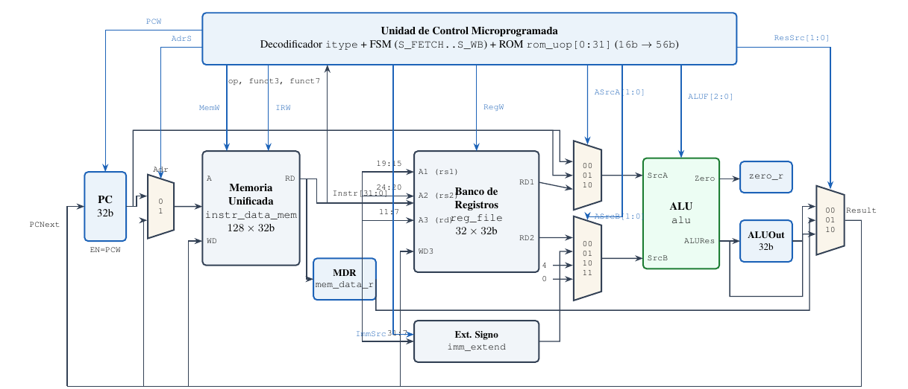

# Procesador RISC-V multiciclo en FPGA Basys 3

**Arquitectura de computadores · SystemVerilog · Control microprogramado · Verificación RTL**

Diseño y análisis de un procesador de 32 bits que reutiliza una ALU y una memoria unificada a lo largo de cuatro estados. El proyecto conecta la organización del datapath con las señales del microcódigo y una interfaz de depuración en la FPGA Digilent Basys 3.

**[Leer informe completo](docs/informe-riscv.pdf) · [Descargar PDF](docs/informe-riscv.pdf?raw=true)**

*Ruta de datos original del informe, figura 1, página 2. Los multiplexores permiten compartir los recursos; los registros intermedios conservan los resultados entre estados.*

## El problema y la solución

Una implementación multiciclo distribuye el trabajo de una instrucción entre varios intervalos de reloj. Este proyecto estudia esa organización mediante un secuenciador fijo y una ROM de control, haciendo visible la relación entre instrucción, estado, señales de habilitación y transferencia de datos.

El alcance documentado es un **subconjunto de instrucciones de RV32I**, con `add`, `sub`, `and`, `or`, `slt`, `beq`, `lw`, `sw` y `addi`. El informe describe formatos adicionales en el extensor de inmediatos; eso no implica que todas las instrucciones de esos formatos estén implementadas. No se presenta una certificación de conformidad con la ISA completa.

| Característica | Implementación documentada |
|---|---|
| Plataforma | Basys 3, Artix-7 XC7A35T |
| Lenguaje | SystemVerilog |
| Ruta de datos | 32 bits |
| Memoria unificada | 128 palabras de 32 bits, 512 bytes |
| Banco de registros | `x1` a `x31`; `x0` fijo en cero |
| Control | ROM de 32 palabras de 16 bits |
| Secuencia | `S_FETCH → S_EX → S_MEM → S_WB` |
| CPI del secuenciador | 4 ciclos por instrucción |

## Cómo funciona

1. **Búsqueda (`S_FETCH`).** La memoria se direcciona con el PC y se captura la instrucción.
2. **Ejecución (`S_EX`).** La ALU opera sobre los registros, el inmediato o las constantes seleccionadas. `ALUOut` y `zero_r` retienen el resultado y la condición de cero.
3. **Memoria (`S_MEM`).** Las instrucciones de carga y almacenamiento utilizan la dirección calculada. Las operaciones aritméticas conservan un estado sin trabajo útil en esta secuencia fija.
4. **Escritura (`S_WB`).** Se actualiza el registro destino cuando corresponde y se selecciona el siguiente PC.

El decodificador asigna un índice `itype` a cada instrucción. Durante la búsqueda se consulta la dirección cero de la ROM; en los demás estados se usa `3 × itype + st`. Cada palabra controla la escritura de memoria y registros, la selección de operandos, la ALU y el resultado de retorno.

Esta separación permite estudiar el **estado arquitectónico** (PC, registros y memoria) y el **estado intermedio** necesario para ejecutar una instrucción durante varios ciclos.

## Depuración y verificación

La interfaz de la Basys 3 permite inspeccionar registros y buses con interruptores y el display de siete segmentos. Incluye avance automático lento, selección de registros, control manual del PC y filtrado antirrebote de los pulsadores. El reloj de referencia de 100 MHz y el pulso de avance lento tienen funciones distintas; el último facilita observar la ejecución.

El informe documenta un banco de pruebas RTL y una traza de 16 instrucciones en 64 ciclos. Entre los resultados de la traza se encuentran `10 + 15 = 25`, `10 - 15 = -5` y la conservación de `x0 = 0` al ejecutar `nop`.

### Hallazgos del microcódigo

La verificación también permitió identificar dos problemas concretos, descritos en la sección IV-B del informe:

| Caso | Comportamiento documentado | Corrección propuesta en el informe |
|---|---|---|
| `sw`, estado de ejecución | Se selecciona un inmediato tipo I; tres escrituras terminan en la misma palabra de memoria | Cambiar `0x00A0` por `0x00A8` en la dirección 22 |
| `beq`, estado de ejecución | El segundo operando es la constante 4 en lugar de `RD2` | Cambiar `0x00C1` por `0x0081` en la dirección 16 |

La tabla de ejecución conserva los resultados de la versión diagnosticada. Estas correcciones están documentadas como propuestas: este repositorio no incluye todavía RTL ni una nueva simulación que demuestre su aplicación.

## Aprendizajes y alcance

El trabajo aborda diseño modular de CPU, decodificación de instrucciones, extensión de signo, temporización, control por ROM y depuración ciclo a ciclo. El CPI fijo facilita explicar el secuenciamiento, pero por sí solo no demuestra mayor rendimiento ni menor área frente a otra implementación; harían falta mediciones comparables de síntesis y frecuencia.

## Archivos y autoría

- `docs/informe-riscv.pdf`: informe original completo, sin modificaciones.
- `assets/datapath.png`: figura extraída del informe para su lectura en GitHub.
- `docs/SHA256SUMS.txt`: huella de integridad del PDF publicado.

**Autor del informe:** Nicolás Salas. Departamento de Ingeniería Eléctrica y Electrónica, Universidad de Concepción, Chile.

Esta entrega del portafolio contiene documentación y figuras. Los archivos `top_complete.sv`, `tb_top.sv`, `.mem` y `.xdc` mencionados en el informe no forman parte de los archivos entregados para esta publicación. Las referencias bibliográficas se conservan en el PDF. La disponibilidad pública no incorpora una licencia adicional sobre los materiales de terceros citados.

## Otros proyectos

[Procesamiento de imágenes en FPGA](https://github.com/TheNicolen/SuperResolucionMedianteInterpolacionBicubicayVecinomasCercanoenunaRegionArbitraria) · [Control PID](https://github.com/TheNicolen/Controlador-PID-de-Nivel-y-flujo-en-planta-de-un-estanque) · [Control adaptativo](https://github.com/TheNicolen/Tecnicas-de-control-adaptativo-de-planta-de-un-estanque)
